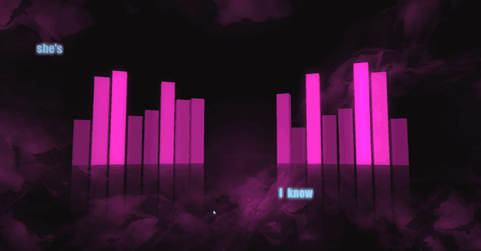
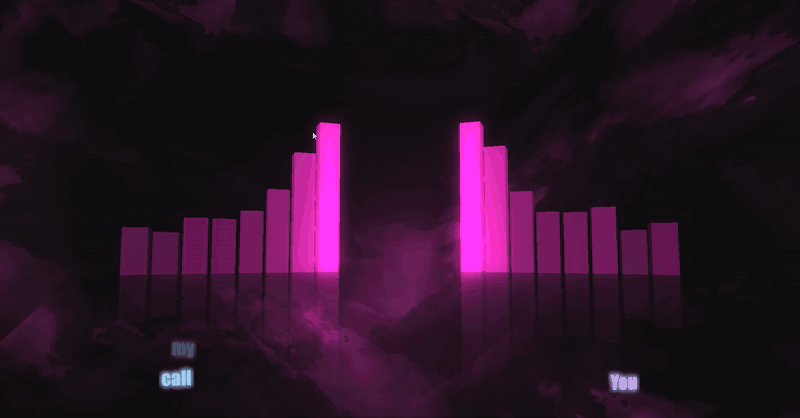
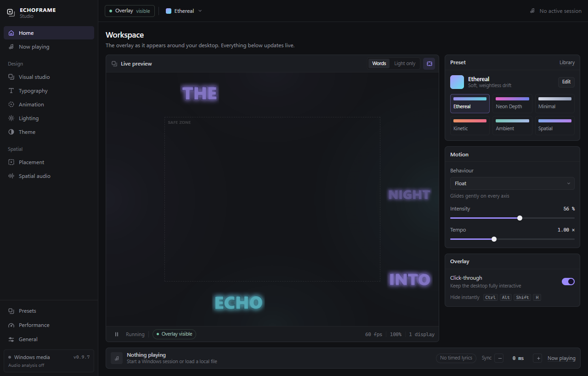
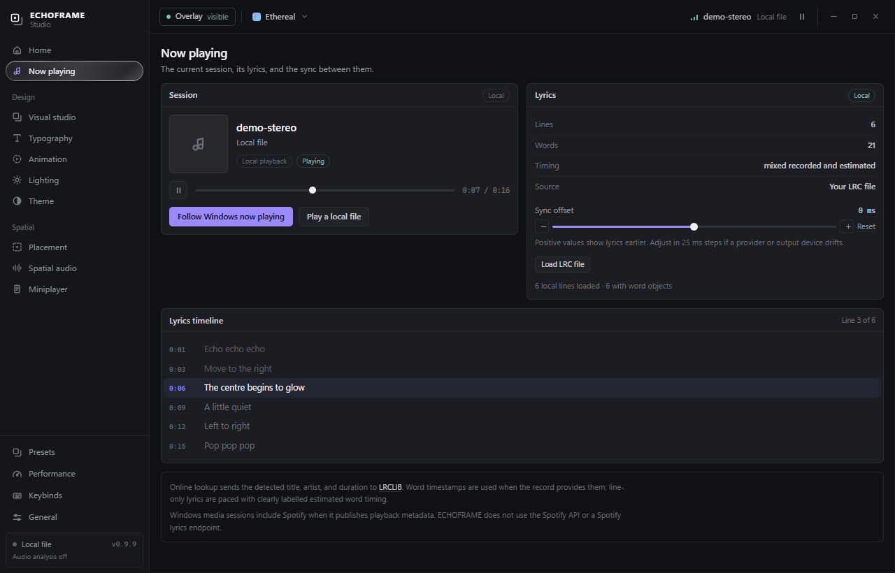
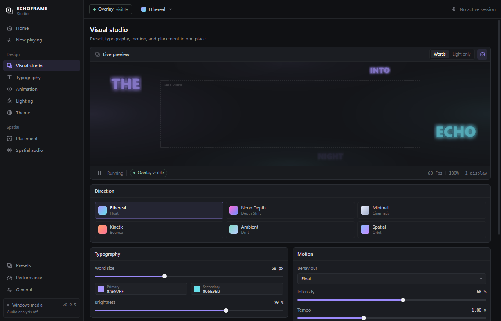
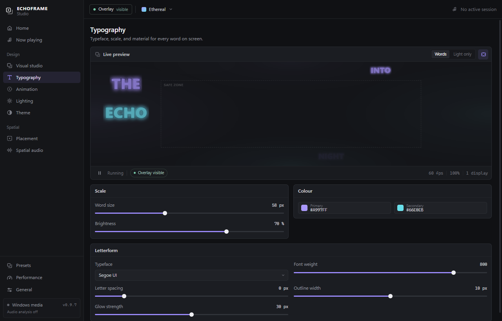

# ECHOFRAME

**Spatial music typography for Windows.** ECHOFRAME follows what you're playing, finds timed lyrics, and renders them as perspective-layered words around the edges of your desktop. The centre of the screen stays usable and every click passes through.



*Words arrive as they are sung, forming a close group for each lyric line. The pink equaliser in these clips is the desktop wallpaper, not part of ECHOFRAME.*

## What it does

ECHOFRAME is a desktop overlay, not a full-screen player. It reads the current Windows media session, looks up timed lyrics on [LRCLIB](https://lrclib.net/docs), and spawns each word at its own timestamp near the edge of the screen. A small placement engine keeps words out of a protected central area, avoids overlapping text, and clusters each line in a readable line, staircase, or vertical arrangement.

Everything else is there to shape that atmosphere: typography, motion, colour, a peripheral light field that reacts to the audio mix, and a studio with a live preview of the real renderer.

- **Word-level, not line-level.** Recorded word timestamps are used when the provider has them. Line-only lyrics get clearly labelled estimated pacing.
- **Follows what you play.** Windows media sessions, including Spotify desktop, are read through the system media controls. Local files work too, with embedded artwork and an optional LRC override.
- **Made for the desktop.** Transparent per-monitor overlays stay on top, ignore the mouse, and leave the protected centre empty. Hide everything with one shortcut.
- **Reactive but local.** Optional WASAPI loopback analysis drives the light field and motion. Audio never leaves the machine.
- **A real studio.** Six starting presets, saved looks, versioned JSON import/export, ten motion behaviours, three placement modes, artwork-derived palettes, and a performance panel.



## Install

Download **[ECHOFRAME 0.9.7](https://github.com/Nitrous-0xide/echoframe/releases/latest)** for Windows 10/11 x64.

The installer is unsigned, so Windows SmartScreen may ask you to confirm before running it. There is no account, telemetry, or background updater.

### First run

1. ECHOFRAME starts with the overlay visible and the studio open on top of it.
2. Play a song in Spotify or another app that publishes Windows media controls. The studio shows the detected track and looks up timed lyrics automatically.
3. Or open **Now playing → Play a local file**, then load a matching `.lrc`.
4. Adjust the look in **Visual studio** or any of the design pages. Every change applies to the overlay immediately.
5. Use **Sync** in the session bar if a provider's timestamps sit slightly ahead or behind the vocal.

The tray icon reopens the studio or hides the overlay. Closing the studio leaves the overlay running.

## Screenshots

| Workspace | Now playing |
|:---:|:---:|
|  |  |

| Visual studio | Typography |
|:---:|:---:|
|  |  |

## How it works

```text
Windows media session (SMTC)        local audio file
        │ title, artist, position            │ HTML audio clock + tags
        ▼                                    ▼
   LRCLIB lookup  ──►  LRC / Lyricsfile  ──►  word events
                                              │
                    placement engine  ◄───────┘
                      edges, safe zone, collisions, line layout
                                              │
   WASAPI loopback ──► features ──► lighting  │
        (optional)                     ┌───────▼────────┐
                                       │  Three.js      │
                                       │  overlay +     │
                                       │  studio preview│
                                       └────────────────┘
```

- `electron/media.ts` and `native/EchoAudio/MediaWatcher.cs` read the Windows Global System Media Transport Controls session and report identity plus playback position.
- `electron/lyricsService.ts` matches LRCLIB records strictly by title, artist, and duration, spaces requests, follows rate-limit responses, caches results, and retries temporary failures.
- `src/lyrics/` parses standard and enhanced LRC, Lyricsfile word timestamps, and estimates pacing for line-only lyrics. `displayEvents.ts` turns lines into individual, ordered word events.
- `src/scene/` contains the Three.js scene, the peripheral placement engine, and the lighting field. The studio preview runs the same scene as the overlay.
- `native/EchoAudio/` is a small .NET 9 + NAudio helper that computes stereo and frequency features from an opt-in WASAPI loopback stream. Only features cross the process pipe.

## Lyric timing

Timing is deliberately conservative:

- **Recorded word timing** from Lyricsfile or enhanced LRC is used directly. Repeated words get independent objects.
- **Line-only lyrics** are paced with a speaking-rate model that is anchored to the line's start, stops before the next line, and never claims to be exact. The studio labels it *estimated*.
- **Line transitions** add at most a short, bounded nudge so two lyric chunks are not on screen at once. Corrections cannot accumulate: the old per-line gap used to add up to seconds of delay by the end of a song, and it no longer can.
- **Sync offset** shifts the whole lyric schedule in 25 ms steps, up to ±750 ms, and is saved with your settings.

If a particular master still feels a word behind, nudge Sync upward. The studio shows whether the current lyrics use recorded, estimated, or mixed timing.

## Privacy

- No accounts, analytics, telemetry, or remote settings.
- Audio analysis is opt-in on every launch, runs locally, and never stores or transmits samples.
- LRCLIB receives only the track title, artist, and duration over HTTPS. See [provider notes](docs/PROVIDERS.md).
- Local audio files stay in the studio window. Only playback position, metadata text, timing, and compact audio features cross the Electron IPC boundary.
- ECHOFRAME does not use the Spotify Platform, Spotify OAuth, or a Spotify lyrics endpoint. It observes the Windows media session that Spotify publishes, when it publishes one. ECHOFRAME is not affiliated with Spotify or LRCLIB.

## Build from source

Requirements: Windows 10/11 x64, Node.js 22 or newer, npm, and the .NET 9 SDK. A WebGL-capable GPU is required for the overlay.

```powershell
git clone https://github.com/Nitrous-0xide/echoframe.git
cd echoframe
npm install
npm run dev
```

`npm run dev` builds the native helper, compiles the Electron main process, starts Vite, and launches the app.

Build an installer:

```powershell
npm test
npm run check
npm run build
```

The installer is written to `release/ECHOFRAME Setup 0.9.7.exe`. It is unsigned.

### Development notes

- `npm run check` runs both TypeScript projects and a production renderer build.
- `npm test` compiles and runs the Node test suite (placement, lyrics, timing, palette, lighting, and retry logic).
- `npm run smoke:visual` renders the studio offscreen, checks key layout and transparency invariants, and writes screenshots to `artifacts/`.
- `npm run smoke:local` loads the synthetic WAV and enhanced LRC and verifies the lyric timeline.
- `npm run smoke:package` starts the built app and checks its IPC, media source, and live lyrics.

## Project layout

```text
electron/                 Electron windows, tray, IPC, media bridge, LRCLIB client
native/EchoAudio/         .NET 9 WASAPI loopback helper and media watcher
src/lyrics/               LRC, Lyricsfile, word timing, display events
src/scene/                Three.js scene, placement engine, lighting
src/theme/                Artwork palette extraction and theme colours
src/main.tsx              Studio and overlay UI
tests/                    Unit tests and Electron smoke tests
docs/PROVIDERS.md         Playback and lyrics provider boundaries
docs/media/               README images and GIFs
```

## Controls

| Action | Shortcut |
|---|---|
| Hide the overlay | `Ctrl` + `Alt` + `Shift` + `H` |
| Toggle the overlay | `Ctrl` + `Alt` + `Shift` + `O` |
| Reopen the studio | `Ctrl` + `Alt` + `Shift` + `S` |

The tray menu also opens the studio, toggles the overlay, and quits.

## Status and limits

ECHOFRAME 0.9.7 is an unsigned Windows preview. The following are known limits rather than hidden behaviour:

- Windows only. Media detection depends on the player publishing metadata and a timeline to the system; some players do not.
- Some tracks have no timed lyrics on LRCLIB. Playback continues without words in that case.
- Line-only lyrics use estimated word pacing, which can drift from sustained or unusually phrased vocals.
- Live capture, click-through, and multi-monitor hotplug still deserve hands-on testing on each target setup.
- No source separation, licensed commercial lyrics provider, content-aware window avoidance, multiple exclusion regions, MSDF text, code signing, or automatic updates.
- The installer is unsigned and may trigger SmartScreen.

## Credits

Built with [Electron](https://www.electronjs.org/), [React](https://react.dev/), [Three.js](https://threejs.org/), and [Vite](https://vite.dev/). Native audio analysis uses [NAudio](https://github.com/naudio/NAudio). Local metadata and artwork come from [music-metadata](https://github.com/Borewit/music-metadata). Timed lyrics are provided by [LRCLIB](https://lrclib.net/). The interface uses the system Segoe UI Variable stack.

## License

[MIT](LICENSE) © 2026 Nitrous-Oxide
