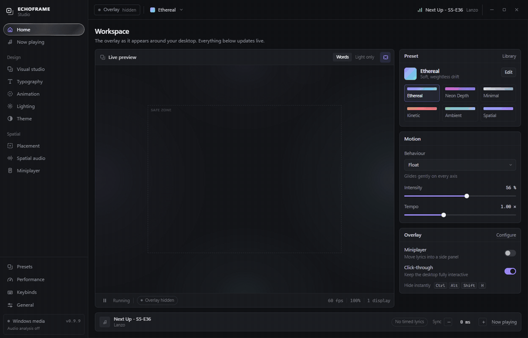
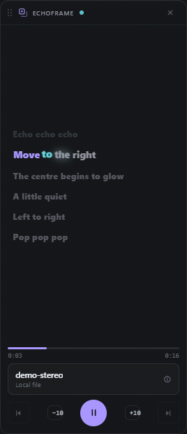
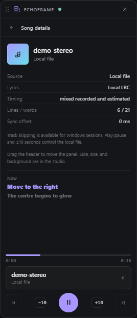
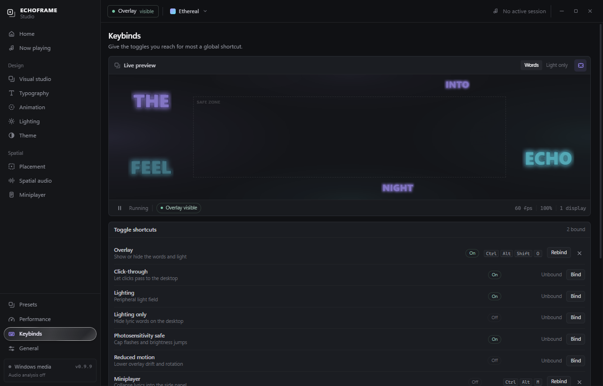

# ECHOFRAME

**Spatial music typography for Windows.** ECHOFRAME follows what you're playing, finds timed lyrics, and renders them as perspective-layered words around the edges of your desktop. The centre of the screen stays usable and every click passes through.


*Words arrive as they are sung, forming a close group for each lyric line. The pink equaliser in these clips is the desktop wallpaper, not part of ECHOFRAME.*

## What it does

ECHOFRAME is a desktop overlay, not a full-screen player. It reads the current Windows media session, looks up timed lyrics on [LRCLIB](https://lrclib.net/docs), and spawns each word at its own timestamp near the edge of the screen. A small placement engine keeps words out of a protected central area, avoids overlapping text, and clusters each line in a readable line, staircase, or vertical arrangement.

Everything else is there to shape that atmosphere: typography, motion, colour, a peripheral light field that reacts to the audio mix, and a studio with a live preview of the real renderer.

- **Word-level, not line-level.** Recorded word timestamps are used when the provider has them. Line-only lyrics get clearly labelled estimated pacing.
- **Follows what you play.** Windows media sessions, including Spotify desktop, are read through the system media controls. Local files work too, with embedded artwork and an optional LRC override.
- **Made for the desktop.** Transparent per-monitor overlays stay on top, ignore the mouse, and leave the protected centre empty. Hide everything with one shortcut.
- **Reactive but local.** Optional WASAPI loopback analysis drives the light field and motion. Audio never leaves the machine.
- **A real studio.** Six starting presets, saved looks, versioned JSON import/export, ten motion behaviours, three placement modes, artwork-derived palettes, and a performance panel.
- **A miniplayer when you want one.** An optional tall panel on either edge collapses the lyrics into a single readable column, with an always-visible minimal transport and song details a click away.
- **Shortcuts and motion, on your terms.** Bind any toggle to a global key, tune or disable studio page animations, and choose a bounce style, speed, or silence for the words in the miniplayer.
- **A frameless studio.** The brand row and toolbar double as the window drag surface, with integrated minimize, maximize, and close controls and a liquid-glass tab selector.


## Install

Download **[ECHOFRAME 0.9.9](https://github.com/Nitrous-0xide/echoframe/releases/latest)** for Windows 10/11 x64.

The installer is unsigned, so Windows SmartScreen may ask you to confirm before running it. There is no account, telemetry, or background updater.

### First run

1. ECHOFRAME starts with the overlay visible and the studio open on top of it.
2. Play a song in Spotify or another app that publishes Windows media controls. The studio shows the detected track and looks up timed lyrics automatically.
3. Or open **Now playing → Play a local file**, then load a matching `.lrc`.
4. Adjust the look in **Visual studio** or any of the design pages. Every change applies to the overlay immediately.
5. Use **Sync** in the session bar if a provider's timestamps sit slightly ahead or behind the vocal.

The tray icon reopens the studio or hides the overlay. Closing the studio leaves the overlay running.

## Screenshots



*Switching sections in the frameless studio: liquid-glass tabs, animated page transitions, and integrated window controls.*

| Workspace | Now playing |
|:---:|:---:|
|  |  |

| Visual studio | Typography |
|:---:|:---:|
|  |  |

## Miniplayer

An optional second surface for the same word-level lyrics. Turn it on and the desktop edge words collapse into a tall panel on either side of the primary display; the peripheral light field stays where it is.

| Lyrics and bounce | Song details |
|:---:|:---:|
|  |  |

The panel keeps a compact transport visible at all times: previous, −10 seconds, play/pause, +10 seconds, and next. The title bar opens song details in place without hiding those controls. Drag the panel by its header; its position is remembered, and changing the side in the studio re-anchors it.

Turn it on from the Home inspector or the **Miniplayer** page. Side, scale, background opacity, and word bounce are set on that page. Each word can bounce as its timestamp is reached: choose Soft lift, Pop, Spring, or Tilt, change the speed, or turn it off for a colour-only highlight. Previous and next tracks go through the Windows media session; play/pause and ±10 seconds also work for local playback. When the panel is on, the edge lyrics are hidden, so the whole lyric stream lives in one place.

## Keybinds and motion

Every toggle in the app can own a global shortcut: overlay, click-through, lighting, lighting-only, photosensitivity, reduced motion, miniplayer, word bounce, audio analysis, the protected rectangle, and menu animations. Open **Keybinds**, press **Bind**, then the combination. Shortcuts require a modifier or an F-key, assigning one moves it from any other action, and combinations already taken by Windows or another app are reported so you can pick another. Hide overlay and Open studio stay fixed so the app is always reachable.



Studio pages and their groups animate in when you switch sections. Set the speed in **General → Interface animations**, or turn menu animations off for instant changes. The miniplayer's bounce has its own style, speed, and on/off setting, so the two can be tuned independently.

## How it works

- `electron/media.ts` and `native/EchoAudio/MediaWatcher.cs` read the Windows Global System Media Transport Controls session and report identity plus playback position. The same helper accepts previous, next, play/pause, and ±10 second commands from the studio or miniplayer.
- `electron/lyricsService.ts` matches LRCLIB records strictly by title, artist, and duration, spaces requests, follows rate-limit responses, caches results, and retries temporary failures.
- `src/lyrics/` parses standard and enhanced LRC, Lyricsfile word timestamps, and estimates pacing for line-only lyrics. `displayEvents.ts` turns lines into individual, ordered word events.
- `src/scene/` contains the Three.js scene, the peripheral placement engine, and the lighting field. The studio preview runs the same scene as the overlay.
- `electron/main.ts` owns a separate frameless miniplayer window. `src/miniplayer/layout.ts` keeps its bounds on either edge, and the renderer paints a lyric column from the same timed data and sync offset as the overlay.
- `native/EchoAudio/` is a small .NET 9 + NAudio helper that computes stereo and frequency features from an opt-in WASAPI loopback stream. Only features cross the process pipe.

## Lyric timing

Timing is deliberately conservative:

- **Recorded word timing** from Lyricsfile or enhanced LRC is used directly. Repeated words get independent objects.
- **Line-only lyrics** are paced with a speaking-rate model that is anchored to the line's start, stops before the next line, and never claims to be exact. The studio labels it *estimated*.
- **Line transitions** add at most a short, bounded nudge so two lyric chunks are not on screen at once. Corrections cannot accumulate: the old per-line gap used to add up to seconds of delay by the end of a song, and it no longer can.
- **Sync offset** shifts the whole lyric schedule in 25 ms steps, up to ±750 ms, and is saved with your settings.

If a particular master still feels a word behind, nudge Sync upward. The studio shows whether the current lyrics use recorded, estimated, or mixed timing.

## Privacy

- No accounts, analytics, telemetry, or remote settings.
- Audio analysis is opt-in on every launch, runs locally, and never stores or transmits samples.
- LRCLIB receives only the track title, artist, and duration over HTTPS. See [provider notes](docs/PROVIDERS.md).
- Local audio files stay in the studio window. Only playback position, metadata text, timing, and compact audio features cross the Electron IPC boundary.
- ECHOFRAME does not use the Spotify Platform, Spotify OAuth, or a Spotify lyrics endpoint. It observes the Windows media session that Spotify publishes, when it publishes one. ECHOFRAME is not affiliated with Spotify or LRCLIB.

## Build from source

Requirements: Windows 10/11 x64, Node.js 22 or newer, npm, and the .NET 9 SDK. A WebGL-capable GPU is required for the overlay.

```powershell
git clone https://github.com/Nitrous-0xide/echoframe.git
cd echoframe
npm install
npm run dev
```

`npm run dev` builds the native helper, compiles the Electron main process, starts Vite, and launches the app.

Build an installer:

```powershell
npm test
npm run check
npm run build
```

The installer is written to `release/ECHOFRAME Setup 0.9.9.exe`. It is unsigned.

### Development notes

- `npm run check` runs both TypeScript projects and a production renderer build.
- `npm test` compiles and runs the Node test suite (placement, lyrics, timing, palette, lighting, and retry logic).
- `npm run smoke:visual` renders the studio offscreen, checks key layout and transparency invariants, and writes screenshots to `artifacts/`.
- `npm run smoke:local` loads the synthetic WAV and enhanced LRC and verifies the lyric timeline.
- `npm run smoke:package` starts the built app and checks its IPC, media source, and live lyrics.
- `npm run smoke:miniplayer` drives the miniplayer's pause and +10 second controls against the built app using the demo track.
- `npm run smoke:window` launches the built app, maximizes and restores the frameless studio through its window-control IPC, then closes the studio.

## Project layout

```text
electron/                 Electron windows, tray, IPC, media bridge, LRCLIB client
native/EchoAudio/         .NET 9 WASAPI loopback helper and media watcher
src/lyrics/               LRC, Lyricsfile, word timing, display events
src/scene/                Three.js scene, placement engine, lighting
src/theme/                Artwork palette extraction and theme colours
src/keybinds.ts           Accelerator parsing and toggle shortcuts
src/miniplayer/           Miniplayer panel geometry
src/main.tsx              Studio, overlay, and miniplayer UI
tests/                    Unit tests and Electron smoke tests
docs/PROVIDERS.md         Playback and lyrics provider boundaries
docs/media/               README images and GIFs
```

## Controls

| Action | Shortcut |
|---|---|
| Hide the overlay | `Ctrl` + `Alt` + `Shift` + `H` (fixed) |
| Toggle the overlay | `Ctrl` + `Alt` + `Shift` + `O` (default, rebindable) |
| Reopen the studio | `Ctrl` + `Alt` + `Shift` + `S` (fixed) |

Open **Keybinds** to assign global shortcuts to any toggle, including the miniplayer, lighting, audio analysis, word bounce, and menu animations. Global shortcuts are exclusive to one owner; if Windows or another app holds a combination, the page reports it.

The tray menu also opens the studio, toggles the overlay, and quits.

Inside the miniplayer, drag the header to move the panel and click the title bar for song details. Side, scale, and background opacity live on the Miniplayer page. When the miniplayer is enabled, lyric words leave the desktop edges and appear in the panel; the overlay's light field stays.

## Status and limits

ECHOFRAME 0.9.9 is an unsigned Windows preview. The following are known limits rather than hidden behaviour:

- Windows only. Media detection depends on the player publishing metadata and a timeline to the system; some players do not.
- Some tracks have no timed lyrics on LRCLIB. Playback continues without words in that case.
- Line-only lyrics use estimated word pacing, which can drift from sustained or unusually phrased vocals.
- Live capture, click-through, and multi-monitor hotplug still deserve hands-on testing on each target setup.
- The miniplayer appears on the primary display and can be dragged anywhere on it. Its position is remembered; changing the side re-anchors it. Track skipping depends on the player implementing Windows transport controls; local playback supports only play/pause and ±10 seconds.
- Global keybinds are exclusive. Another app, or a second ECHOFRAME instance, can own a combination; the Keybinds page lists anything that could not be registered.
- No source separation, licensed commercial lyrics provider, content-aware window avoidance, multiple exclusion regions, MSDF text, code signing, or automatic updates.
- The installer is unsigned and may trigger SmartScreen.

## Credits

Built with [Electron](https://www.electronjs.org/), [React](https://react.dev/), [Three.js](https://threejs.org/), and [Vite](https://vite.dev/). Native audio analysis uses [NAudio](https://github.com/naudio/NAudio). Local metadata and artwork come from [music-metadata](https://github.com/Borewit/music-metadata). Timed lyrics are provided by [LRCLIB](https://lrclib.net/). The interface uses the system Segoe UI Variable stack.

## License

[MIT](LICENSE) © 2026 Nitrous-Oxide
